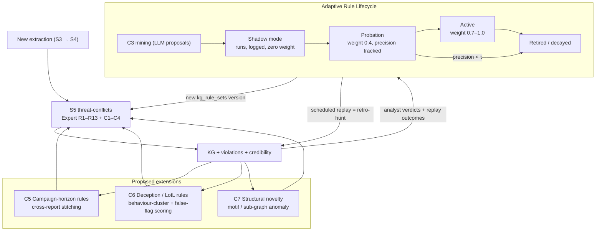

# Dynamic Rule-Set Updates and Adaptive Defence Against Novel and Long-Cycle APT Patterns

**Status:** analysis and design report. Nothing in it is implemented yet unless marked *implemented*.
**Scope:** CTI domain, Pathway B (backbone) stage S5 `threat-conflicts`, Hybrid Rule Governance (HRG).
**Posture:** zero-shot, frozen backbone. Every adaptive mechanism below changes **rules, thresholds or evidence**, never model weights.

---

## 1. The critique

> Threat intelligence covers many covert techniques and long-cycle APTs. Temporal consistency and graph-structure validation alone may not catch every logical weakness. The rule set needs dynamic update mechanisms and an adaptive way to handle novel, unknown attack patterns.

The critique is fair. Checks R1–R10, C1 and C2 test whether **one extraction is internally consistent**: is the order correct, is the graph connected, is it STIX-valid, is the kill chain plausible. They do not test:

1. **Cross-report, long-horizon consistency.** An APT campaign spread over 6–36 months appears as many separate reports.
2. **Deliberate deception**: false flags, borrowed tooling, living-off-the-land (LotL) techniques that look benign on their own.
3. **Truly novel patterns**: techniques or relation shapes the rulebase has never encoded.
4. **Rule decay**: rules that were correct when written but became noisy or obsolete as the threat landscape moved.

## 2. What already exists (verified in code)

| Mechanism | Where | What it gives against the critique | Limit |
|---|---|---|---|
| Versioned rule registry + fingerprint | `_shared/rules/registry.ts` (`RULE_KERNEL_VERSION`, `registryFingerprint`), table `kg_rule_sets` | Rule sets can change without losing reproducibility; every run is stamped | Updates are manual code releases |
| Deterministic replay | `src/lib/rule-replay.ts`, table `kg_rule_replays` | Old KG outputs can be re-scored under a new rule set (a retro-hunt over rules) | Replay is on request, not scheduled |
| C3 LLM rule mining + human review | `threat-conflicts-mine` → `kg_conflict_rule_candidates` → Rule Governance panel | Path for new rules from observed evidence | Accepted rules still have to be compiled into `mined.generated.ts` by hand; the sink is currently empty |
| C4 novelty flag (R16) | `_shared/rules/anomaly.ts` | Relation labels never or rarely seen are flagged (warning only) | Looks only at **label frequency**, not at structure, technique or time |
| C1 drift window (R10) | `_shared/rules/temporal.ts` | Flags causal spans over 180 days that have no intermediate stage | A fixed window is wrong for APTs, where long dwell time is normal |
| Provenance-weighted credibility | `provenancePenalty` (expert 1.0 > adaptive 0.7 > mined 0.4) | New rules can be introduced at low influence | Weights are static |

**Conclusion:** the *infrastructure* for dynamic rules (versioning, replay, a candidate pipeline, novelty flagging) is already in place. What is missing is the **closed loop** (automatic promotion, expiry and threshold adaptation) and the **long-horizon and deception-aware rule families**.

## 3. Gap analysis

| Gap | Example | Why the current checks miss it |
|---|---|---|
| G-A Long-cycle fragmentation | Initial access in report #1 (Jan), lateral movement in #7 (Aug), exfiltration in #12 (next Mar) | Each report is checked alone; R10 even penalises the long span |
| G-B Low-and-slow / LotL | PowerShell, WMI, valid accounts (T1078) | Each technique is benign and common, so R16 sees nothing novel |
| G-C False flags | Borrowed Lazarus tooling used by another actor | R2/R6 flag the contradiction but cannot weigh *deception* against *overlap* |
| G-D Structural novelty | A familiar label in an unseen sub-graph shape (e.g. a supply-chain → cloud-identity pivot) | R16 counts labels, not motifs |
| G-E Rule staleness | A rule that fired correctly in 2022 now mostly gives false positives | No precision tracking per rule, so no decay |
| G-F Unknown technique | Behaviour with no ATT&CK ID yet | kb-validate rejects ungrounded techniques as hallucinations; no "novel, unconfirmed" status |

## 4. Proposed design: Adaptive Rule Lifecycle (ARL) + three new detection families

### 4.1 Architecture

### 4.2 Dynamic update mechanism: the Adaptive Rule Lifecycle

| Stage | Entry criterion | Effect on KG | Exit |
|---|---|---|---|
| **Proposed** | C3 candidate or analyst-authored rule | None | Human accept → Shadow |
| **Shadow** | Compiled predicate, new `kg_rule_sets` version | Runs on every extraction; firings are logged, weight = 0 | ≥ N₀ firings (e.g. 20) **and** human spot-check precision ≥ 0.6 |
| **Probation** | Shadow passed | Weight 0.4 (current `mined` weight) | Precision ≥ 0.8 over a rolling 90 days → Active; < 0.5 → Retired |
| **Active** | Probation passed | Weight 0.7 (adaptive) or 1.0 (if an expert endorses it) | Precision decay below τ → Probation |
| **Retired** | Decay or analyst decision | Not executed; kept in snapshots for replay | Can be re-proposed |

The key properties:

- **Precision per rule**, measured from analyst verdicts on violations (confirm or dismiss in the Rule Governance panel) and from replay disagreement. Precision is a Beta(α, β) posterior, so a rule with few firings stays uncertain.
- **Time-decayed evidence**, half-life e.g. 180 days, so stale rules lose weight automatically (G-E).
- **Every promotion or demotion is a new `kg_rule_sets` version**, so replay and audit guarantees are unchanged.
- **Scheduled retro-hunt**: when a rule reaches Probation, `kg_rule_replays` re-scores the last *k* months of KG output. A new IOC or TTP rule then retroactively surfaces old reports that match it. This is the standard CTI retro-hunt practice applied to rules.
- **Adaptive thresholds**: fixed constants such as R10's 180 days and R16's 3σ become per-actor or per-sector parameters estimated from history, e.g. the drift window is set to the 95th percentile of observed dwell time for that actor class.

### 4.3 C5: campaign-horizon rules for long-cycle APTs (G-A)

Stitch reports into **campaign hypotheses** using shared actor or alias, infrastructure, malware family and victim sector (Jaccard overlap ≥ θ). Then evaluate kill-chain rules on the **campaign graph**, not on the single report:

- **R17 campaign_progression**: a later report advances the kill chain of an open campaign. This is informational and raises confidence instead of warning.
- **R18 dormant_reactivation**: infrastructure or malware seen in a campaign with more than 6 months of silence. Reported as a warning for analyst attention.
- **R19 campaign_gap**: the campaign shows *impact* with no recorded access phase in any linked report, so there is a missing-intelligence prompt.
- R10 becomes campaign-aware: a long span is *expected* inside a stitched APT campaign and is penalised only for unlinked one-off reports.

### 4.4 C6: deception and covert-technique rules (G-B, G-C)

- **LotL co-occurrence scoring.** Individually benign techniques (T1059.001, T1047, T1078, T1021) are scored as a **bundle**. A bundle whose co-occurrence probability under historical KG statistics is low is flagged as a covert-chain warning.
- **False-flag likelihood.** When R2/R6 fire, compute evidence asymmetry: hard indicators (infrastructure, code reuse with build artefacts, victimology) against soft ones (strings, language artefacts, claimed attribution). Attribution supported mainly by soft indicators is downgraded and the competing actor is kept as an alternative.
- **Dempster–Shafer combination** (see `D-S application.md`): conflicting attribution evidence keeps mass on Θ ("unknown operator") instead of forcing a single actor. The conflict mass *K* itself becomes a deception signal.

### 4.5 C7: structural novelty, for unknown patterns (G-D, G-F)

- Extend R16 from **label frequency** to **motif frequency**: count typed 2–3-hop patterns (e.g. `malware —uses→ attack-pattern —targets→ identity`) and flag rare or unseen motifs.
- Optionally, use pgvector distance of the report's sub-graph embedding to its nearest historical neighbours (the `threat_reports.embedding` column already exists) as a second novelty signal.
- **"Novel-unconfirmed" status** for techniques that cannot be grounded in ATT&CK: kept with low confidence and routed to analyst review, instead of being silently counted as hallucinations by kb-validate. This separates *novel* from *hallucinated*. The two are told apart by source reliability and corroboration across independent reports.
- Novel motifs that recur in ≥ 2 independent sources feed C3 as mining evidence, so unknown patterns become candidate rules. This closes the loop with §4.2.

### 4.6 External update feeds

Feed rule updates from authoritative sources, which already have ingest functions: MITRE ATT&CK release diffs (new or revoked techniques → ontology and C2 phase map), CISA KEV additions (→ IOC/CVE rules), PSIRT RSS. Each feed update produces a **proposed** rule-set version that goes through the same lifecycle. Nothing is auto-activated.

## 5. How proactivity and robustness improve

| Property | Today | With ARL + C5–C7 |
|---|---|---|
| Rule evolution | Manual release + C3 proposals | Lifecycle with shadow → probation → active → retired, precision-driven |
| Stale rules | Persist forever | Decay and auto-demote |
| Long-cycle APTs | Single-report checks; long spans penalised | Campaign stitching; spans judged against actor-specific dwell statistics |
| Covert / LotL | Invisible (benign individually) | Bundle-level co-occurrence scoring |
| False flags | Contradiction flagged, not weighed | Hard/soft evidence asymmetry + D-S conflict mass |
| Unknown patterns | Label-level novelty warning | Motif + embedding novelty, novel-unconfirmed status, recurrence → rule mining |
| Proactive hunting | None | Scheduled retro-hunt replay when a rule is promoted |

## 6. Evaluation protocol (proposed)

1. **Temporal hold-out.** Freeze the rule set at time *t*; feed reports after *t* in order; measure how fast and how precisely the lifecycle adapts (time-to-detect a new pattern, false-positive rate per rule).
2. **Long-cycle gold set.** 10–20 multi-report APT campaigns from public reporting (e.g. APT29 2020–2021, Volt Typhoon 2023–2024), each split into dated fragments. Metric: campaign-linkage F1 and kill-chain completeness.
3. **Deception set.** Public false-flag cases (e.g. Olympic Destroyer). Metric: whether the downgraded attribution is ranked below the true actor.
4. **Novelty set.** Hold out ATT&CK techniques added in a later release; check that C7 flags them as novel-unconfirmed rather than hallucinated.
5. Report precision and recall per rule family with Wilson CIs and McNemar's test against the current rule set, as the existing KG-Bench practice does.

## 7. Risks and limits

- **Feedback poisoning:** an adversary can feed crafted reports to make a rule decay. Mitigations are source-reliability weighting, the analyst gate on promotion, and the rule that expert rules can never be retired automatically.
- **Campaign over-stitching:** a loose Jaccard threshold merges unrelated actors, which reproduces the false-flag problem. Stitched campaigns are hypotheses with their own confidence.
- **Data scarcity:** with the 56 gold cases, per-rule precision estimates will be wide. This is why the Beta posterior is used and why the long-cycle gold set (§6.2) is a prerequisite.
- **Analyst workload:** shadow mode and batching limit review volume; the workload is still real.
- **Zero-shot preserved:** no step trains the LLM. Adaptation lives entirely in versioned, replayable symbolic artefacts.

## 8. Suggested implementation order

1. Close the C3 loop: compile accepted candidates into `mined.generated.ts` automatically and add the shadow stage.
2. Track precision per rule from analyst verdicts, and add decay.
3. Adaptive thresholds for R10 and R16.
4. C7 motif novelty + the novel-unconfirmed status.
5. C5 campaign stitching + R17–R19.
6. C6 LotL bundles + false-flag scoring (depends on D-S).
7. Scheduled retro-hunt replay + external feed-driven rule proposals.

## Related documents

`hybrid-rule-governance-clarification.md` · `adaptive-layers-clarification.md` · `symbolic-rules-formal-specification.md` · `D-S application.md` · `graph-native-boundary-examples.md` · `zero-shot-attestation.md`
