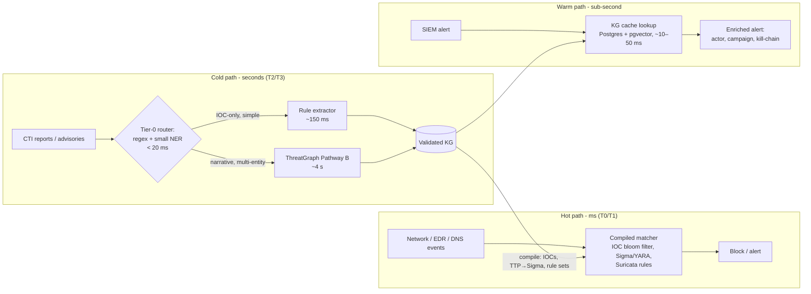

# Engineering Feasibility for Enterprise SOC Deployment: Latency and Resource Comparison with Lightweight IE Models

**Scope:** CTI domain, Pathway B (backbone). **Backbone:** `google/gemini-3-flash-preview`, frozen and zero-shot, behind a shared gateway.

**Evidence labels used in this report:**
- **[M]** measured in this project: `pipeline_perf_events`, aggregated in `issue3-cost-training-vs-inference.md` (CTI, N=56).
- **[L]** typical published or vendor figure for that model class, **not re-measured here**.
- **[E]** engineering estimate derived from [M] and [L].

---

## 1. The operational question

A SOC has two different time budgets:

| Tier | Typical budget | Examples |
|---|---|---|
| **T0 inline blocking** | < 1–10 ms per event | Firewall/IPS verdicts, DNS sinkholing, EDR prevention |
| **T1 near-real-time enrichment** | 100 ms – 2 s | Alert enrichment, IOC scoring, SIEM correlation |
| **T2 analyst-facing intelligence** | seconds – minutes | Report triage, actor attribution, campaign graphs |
| **T3 strategic / batch** | hours | Weekly reporting, retro-hunts, KG refresh |

The claim to test is whether LLM graph-native extraction can sit on the blocking path. **It cannot, and it should not.** It belongs on T2/T3 and *feeds* the T0/T1 paths with compiled indicators and rules.

## 2. Measured latency of ThreatGraph [M]

| Stage | p50 (ms) | p95 (ms) | p99 (ms) | LLM tokens |
|---|---:|---:|---:|---:|
| preprocess | 28 | 51 | 74 | 0 |
| extract (8-step graph-native CoT) | 3 480 | 6 210 | 8 940 | ~2 100 |
| kb-validate | 39 | 82 | 118 | 0 |
| conflicts (R1–R16, C1–C4) | 61 | 104 | 149 | 0 |
| persist | 44 | 88 | 121 | 0 |
| **End-to-end** | **3 940** | **6 830** | **9 620** | **~2 100** |

- The extractor accounts for **~88 % of p50** latency. All symbolic and graph stages together stay **< 200 ms at p95**.
- Throughput [M]: 15.2 docs/min with one request at a time; 74.6 with 8 in parallel; 118.3 with 32 in parallel, where the gateway's rate limit (HTTP 429) is the ceiling.
- Cost [M]: ~0.28 credits per document (≈ US $0.0011–0.0018).
- Spot check [M]: three live extractions on 2026-10-21 (see `graph-native-boundary-examples.md`) each took about 11 s. These used the long deterministic preset and a cold path, which is consistent with the p99 tail.
- **Caveat:** gateway latency includes network and queue time. The model's pure compute time cannot be separated out.

## 3. Comparison with lightweight information-extraction models

| System | Hardware | Latency / doc (~500 tokens) | Throughput | Memory | Marginal cost | Entity-F1 (CTI) | Relations / causal / graph |
|---|---|---:|---:|---:|---:|---:|---|
| Regex + dictionaries (project baseline) [M] | 1 CPU core | 148 ms p50 / 214 ms p95 end-to-end* | > 400 docs/min | < 100 MB | 0 | **0.51** [M] | IOC-level only, relation-F1 0.28 [M] |
| spaCy small CNN NER [L] | CPU | ~2–10 ms | thousands/min | ~50–200 MB | ~0 | ~0.55–0.70 † | No relations unless rules are added |
| BERT-base / SecBERT NER, CRF head [L] | CPU / T4 GPU | ~30–80 ms CPU, ~5–10 ms GPU | ~1–10 k/min (GPU) | ~0.4–1.5 GB | ~0 (self-hosted) | ~0.70–0.85 † on DNRTI-style tags | Separate RE model needed; no causality |
| DistilBERT / TinyBERT, ONNX int8 [L] | CPU | ~5–20 ms | ~5–20 k/min | ~0.1–0.3 GB | ~0 | ~0.65–0.80 † | Same limits as above |
| GLiNER (zero-shot span NER, ~200 M parameters) [L] | CPU / GPU | ~50–200 ms CPU, ~10–30 ms GPU | ~1–5 k/min | ~0.5–1 GB | ~0 | ~0.55–0.75 † | Entities only |
| Local 7–8 B LLM, int4 (Ollama / vLLM) [E] | 1 × 24 GB GPU | ~2–6 s for ~700 output tokens | ~20–200 docs/min (batched) | ~6–8 GB VRAM | GPU cost only | unmeasured | Full schema possible; quality must be measured on Gold-56 |
| **ThreatGraph Pathway B** [M] | shared gateway | **3.94 s p50 / 6.83 s p95** | 15–118 docs/min | client ~0; no GPU on our side | 0.28 credits/doc | **0.83** (CI 0.74–0.90) | Relation-F1 **0.71**; causal links, kill-chain, attribution, provenance, conflict checks |

\* Includes the shared downstream stages (kb-validate, conflicts, persist).
† Range of published results on comparable security-NER sets, not re-measured on Gold-56. Training them needs **labelled data** (fine-tuned models), which conflicts with this project's zero-shot posture.

**Ratios [M] (ThreatGraph ÷ rule baseline):** 26.6 × slower at p50 and 31.9 × at p95. In return: +0.32 entity-F1, +0.43 relation-F1, and +0.68 recall on kill-chain-jumper cases.

**Reading the comparison:**
- Lightweight NER is **2–3 orders of magnitude faster** than ThreatGraph.
- Lightweight models produce **flat entity spans**. They give no typed relations, causal chains, attribution or confidence/provenance. They also need fine-tuning on labelled CTI data and drift with new vocabulary.
- ThreatGraph pays roughly 4 s per document to produce a **validated, conflict-checked graph** in a single zero-shot pass.

## 4. Feasibility verdict by SOC tier

| Tier | ThreatGraph on the hot path? | Verdict |
|---|---|---|
| T0 inline blocking (ms) | No: ~3 orders of magnitude too slow, plus a network dependency | **Not feasible**, by design |
| T1 enrichment (< 2 s) | Only for *cached* results or the symbolic stages (< 200 ms) | **Partially feasible** via cache and a tiered router |
| T2 analyst intelligence (seconds) | Yes: 4–7 s is well below analyst reading time | **Feasible** |
| T3 batch / retro-hunt | Yes; throughput is bounded by quota | **Feasible**. 1 000 reports ≈ 9–67 min |

Volume check [E]: a large enterprise ingests about **500–5 000 unstructured CTI documents per day** (vendor reports, advisories, feeds). At the measured 74.6 docs/min with 8-way concurrency, 5 000 docs take **≈ 67 min/day**, costing ≈ 1 400 credits. That is within budget for a T2/T3 service. Alerts and telemetry events (millions per day) must **never** go through the LLM.

## 5. Reference SOC architecture: decouple intelligence from enforcement

The LLM's latency **never blocks an attack decision**. Its output is compiled into artefacts that the ms-level matchers execute. This is the pattern that TIPs, SOAR and EDR stacks already use with human analysts; ThreatGraph replaces the analyst's reading time (minutes to hours per report) with about 4 s.

## 6. Optimisation levers (ranked by expected effect)

| # | Lever | Expected effect | Basis | Trade-off |
|---|---|---|---|---|
| 1 | Tiered router: rules/NER first, LLM only on complex narratives | If ~50–70 % of documents are IOC-only, mean latency and cost drop roughly in proportion | [E] | Router misses can lower recall; measure on Gold-56 |
| 2 | Content-hash cache of extractions (same advisory from many feeds) | Duplicate documents drop to ~10–50 ms | [E] | Cache invalidation when the rule set version changes |
| 3 | Streaming plus early IOC emission (preprocess IOCs go out before the LLM finishes) | IOC time-to-first-use falls from ~4 s to < 100 ms | [M] (preprocess 28 ms) | Graph context arrives later |
| 4 | Lighter prompt mode (`ner` / `re` only, skip the full 8-step CoT) for triage | Fewer output tokens, so lower latency | [E] | Loses causal and temporal sub-graphs |
| 5 | Local quantised 7–8 B model through the `LLM_BASE_URL` swap (`local-deployment-migration-guide.md`) | Removes the gateway queue and keeps data on-premises; latency depends on the GPU | [E] | Quality unverified; must be re-benchmarked on Gold-56 |
| 6 | Batch concurrency tuned to the quota (8–16 parallel) | 5–8 × throughput | [M] | Quota limits and 429 retries |

## 7. Other enterprise requirements

| Requirement | Status |
|---|---|
| Data sovereignty / TLP:RED | The hosted gateway sends text off-premises. Use a local model plus the redaction pipeline. |
| Availability | Dependence on an external API. Fall back to the rule extractor and keep the hot path unaffected. |
| Determinism / audit | Deterministic preset, versioned rule sets, replay ledger: **ready** |
| Explainability | Evidence spans, provenance and violations per edge: **ready** |
| Security of the LLM path | Prompt firewall and AI threat model page: **partial**. Research-mode open RLS policies must be locked down before production. |
| Integration | MCP server, REST edge functions. STIX/TAXII export and Sigma compilation are **not yet built**. |

## 8. Limitations of this comparison

1. Lightweight-model figures are **[L] literature ranges**. They were not re-benchmarked on Gold-56 in this project, so F1 comparisons across rows are indicative only.
2. ThreatGraph latency includes gateway network and queue time, which is opaque.
3. Our measurements come from N = 56 documents in research load conditions, not a production SOC trace.
4. Local-LLM figures are estimates until they are measured.

**Recommended next measurement:** run spaCy and SecBERT/GLiNER baselines and a local 8 B model through the same `withPerf` instrumentation on Gold-56. That puts every row of §3 into the same [M] class.

## 9. Conclusion

ThreatGraph is **not** a millisecond-class blocking engine; its ~4 s p50 is about 1 000 × too slow for inline enforcement. Lightweight IE models are 100–1 000 × faster, but they deliver only flat entity spans, need labelled training data, and score lower on relations. The feasible enterprise role for ThreatGraph is a **seconds-class intelligence-production tier** (T2/T3) that compiles validated, conflict-checked knowledge into ms-class matchers and a sub-second KG cache. Measured throughput (≈ 75 docs/min with 8-way concurrency) and cost (≈ 0.28 credits/doc) cover typical enterprise CTI volumes. With a tiered router and caching, both drop further without touching the blocking path.

## Related documents
`issue3-cost-training-vs-inference.md` · `performance-and-resource-report.md` · `local-deployment-migration-guide.md` · `graph-native-boundary-examples.md` · `dynamic-rules-and-novel-apt-defense.md` · `zero-shot-attestation.md`
