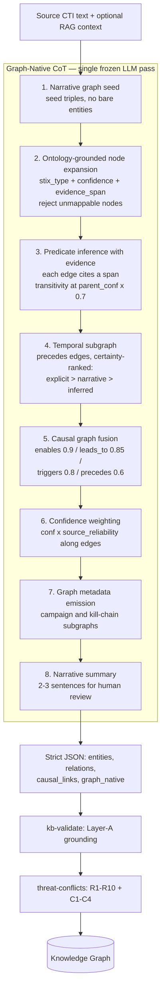

# Graph-Native Chain-of-Thought — Prompt Engineering Principles and Internal Logical Transmission

**Version:** 1.0 · **Date:** 2026-10-21 · **Scope:** CTI Pathway B extraction stage (`threat-extract` edge function, `GRAPH_NATIVE_COT_PROMPT`)
**Purpose:** Elaborate how the Graph-Native CoT prompt generates intermediate reasoning steps while preserving the graph's topological integrity, and why this embedded extraction is substantively superior to external, post-hoc parsing.

---

## 1. The core idea: thinking in triples, not extracting then assembling

Conventional LLM-based KG construction is a **two-stage pipeline**: (1) the model produces free-form text or an entity list; (2) an external parser assembles entities and relations into a graph. Topology is an *artifact of post-processing* — the model never sees the graph it is implicitly building, so it cannot reason about cycles, dangling edges, transitive closure, or confidence flow.

Graph-Native CoT inverts this. From the first reasoning step, **every observation is formalized as a triple inside the reasoning chain itself**. The model does not describe a threat and then get parsed; it *thinks* `(campaign_X, attributed-to, actor_Y)` and continues reasoning over the growing graph. The graph is the chain-of-thought's working memory, not its byproduct.

This is why we call the knowledge "embedded": the graph structure is constructed **during** inference, inside the model's own reasoning trace, under a single frozen zero-shot pass.

---

## 2. The eight steps and their logical transmission mechanism

The prompt (`supabase/functions/threat-extract/index.ts`) fixes eight ordered steps. Order is load-bearing: each step consumes the partial graph produced by the previous steps and emits a strictly richer one. The transmission rules between steps are what preserve topology.

### Step-by-step transmission rules

| Step | Input from previous steps | What it emits | Topology-preserving rule |
|---|---|---|---|
| **1. Narrative seed** | Raw text | Seed triples | No bare entity list is allowed — the first token of structure is already an edge, so every later node is born connected. |
| **2. Node expansion** | Seed triples | Typed nodes with `stix_type`, `confidence`, `evidence_span` | A node that cannot map to the ontology is **rejected**, not deferred — the graph can never accumulate untyped orphans that an external parser would silently keep. |
| **3. Predicate inference** | Typed nodes | Edges with evidence spans | Transitivity is applied **in-trace** at `parent_conf × 0.7`: inferred edges carry a discounted confidence derived from their parent path, so provenance of inference is encoded in the edge weight itself. |
| **4. Temporal subgraph** | Nodes + edges | `precedes` edges | Temporal certainty is ranked `explicit_timestamp > narrative_order > inferred` — the model must declare *how* it knows the order, giving the downstream C1 temporal rules a graded signal instead of a bare claim. |
| **5. Causal fusion** | Temporal + relational subgraph | Causal edges | `causal_conf = min(temporal_conf, relational_conf) × causal_weight` with fixed weights (`enables` 0.9, `leads_to` 0.85, `triggers` 0.8, `precedes` 0.6). A causal edge can never be more confident than its weakest supporting dimension — weakest-link semantics enforced at generation time. |
| **6. Confidence weighting** | Full graph | Reliability-discounted confidences | `conf × source_reliability` propagates along edges, so a low-reliability source taints its entire downstream subgraph proportionally — not just the node it mentioned. |
| **7. Metadata emission** | Weighted graph | Subgraph groupings (campaigns, kill-chains) | Groupings reference existing node IDs only; no new nodes may appear after step 6, freezing the vertex set before serialization. |
| **8. Summary** | Frozen graph | Prose | Prose is generated **from** the graph, last — it can describe but never alter structure. |

### The strict output contract

The trace terminates in a fixed JSON schema (`entities`, `relations`, `causal_links`, `graph_native` with `nodes`/`edges`/`subgraphs`). Because the schema is the *serialization of the reasoning trace* rather than a separate generation, the emitted graph is guaranteed to be the same graph the model reasoned over. This contract is what KG-Bench scores against, and it is why a schema change requires bumping the gold corpus.

---

## 3. Why topology survives: three mechanisms

1. **Monotone growth.** Each step only adds nodes/edges or annotates existing ones; nothing is reordered, merged, or deleted mid-trace. The partial graph at step *k* is a subgraph of the graph at step *k+1*. External parsers violate this constantly (entity linking merges nodes after the fact, breaking edge provenance).

2. **Confidence as transmitted state.** Confidence is not attached at the end — it is *computed through* the trace: transitivity discount (×0.7), causal weakest-link (min × weight), source reliability (× reliability). The final edge weight encodes the entire inference path that produced it. An external parser sees only final labels and must invent confidences post-hoc.

3. **Evidence spans as anchors.** Every node and edge carries an `evidence_span` into the source text, assigned at the moment of creation. This makes every topological claim auditable and gives `kb-validate` and the conflict rules (R1–R10, C1–C4) a concrete target — hallucination control downstream is only possible because grounding happened upstream, in-trace.

---

## 4. Substantive advantages over external, independent parsing

| Property | Graph-Native CoT (embedded) | External parsing (two-stage) |
|---|---|---|
| **Model awareness of structure** | The model reasons over the partial graph at every step; cycles, dangling edges, and missing links are visible during generation | The model never sees a graph; structure is assembled by code it cannot influence |
| **Confidence semantics** | Path-derived: transitivity discount, causal weakest-link, reliability propagation computed in-trace | Invented post-hoc or copied from a single model self-rating |
| **Evidence grounding** | Every edge cites a span at creation time | Parser must re-align mentions to text; alignment errors compound |
| **Ontology enforcement** | Unmappable nodes rejected during reasoning (step 2) | Rejection happens after generation, orphaning the edges that referenced them |
| **Hallucination surface** | Constrained: schema + ontology + evidence requirements narrow the output space at every step | Wide: free-form first stage can fabricate freely; parser faithfully serializes fabrications |
| **Auditability** | The reasoning trace *is* the graph's provenance | Provenance must be reconstructed; the trace and the graph can diverge silently |
| **Empirical signal** | Ablation (`ablation_update.md`): removing CoT changes entity F1 and collapses relation F1 in 2 of 3 runs — the in-trace structure is doing measurable work | NO_COT arm is the proxy for this approach |

The ablation data deserves emphasis: the NO_COT variant (vanilla prompt + same downstream KB/symbolic guards) is precisely the "external parsing" configuration — the model emits a flat JSON and the post-processing does the work. Its higher false-entity rate profile and generally lower relation F1 show that the topology-preserving trace is not cosmetic: it changes what the model commits to.

---

## 5. Interaction with the rest of the pipeline

- **RAG context** is prepended via the `rag_context` parameter; when empty, the model is instructed to rely solely on the source text (no parametric recall leakage into the graph).
- **kb-validate** receives an already-grounded graph; its job is checking against Layer-A canonical knowledge (MITRE/CVE/CAPEC), not repairing structure.
- **threat-conflicts** consumes edge confidences that already encode transitivity, causality, and reliability — the symbolic rules (R1–R10) and adaptive layers (C1–C4) operate on semantically meaningful weights.
- **Domain swap** (CTI ↔ Clinical) changes only the ontology vocabulary in step 2 (STIX SDO/SRO vs ICD-10/RxCUI/LOINC); the eight step labels and all transmission rules are unchanged.

---

## 6. Limits, stated plainly

- **Single-model dependence.** All steps run on one frozen backbone (`google/gemini-3-flash-preview`); a model swap can shift every transmission behavior. The prompt is model-agnostic by construction but not model-independent in effect.
- **Trace length bounds graph size.** Very long advisories exhaust the reasoning budget before step 7; chunking strategies trade topology preservation for coverage.
- **Confidence calibration is heuristic.** The 0.7 / 0.9 / 0.85 / 0.8 / 0.6 weights are expert-set constants, not learned — they are auditable and stable, but not empirically optimized (deliberately, given the zero-shot posture).
- **No formal guarantee.** Monotonicity and schema conformance are enforced by prompt design and downstream validation, not by a constrained decoder; a malformed trace is caught by `kb-validate`, not prevented.

---

## 7. Reproduction pointers

- Prompt: `GRAPH_NATIVE_COT_PROMPT` in `supabase/functions/threat-extract/index.ts`.
- Schema and stage contracts: `pipeline-stage-contracts` documentation; gold expectations in `src/lib/kg-bench/corpus.ts`.
- Ablation evidence: `public/reports/ablation_update.md` (NO_COT arm).
- Ontologies: `src/lib/ontology/cti.ts`, `src/lib/ontology/clinical.ts`.
